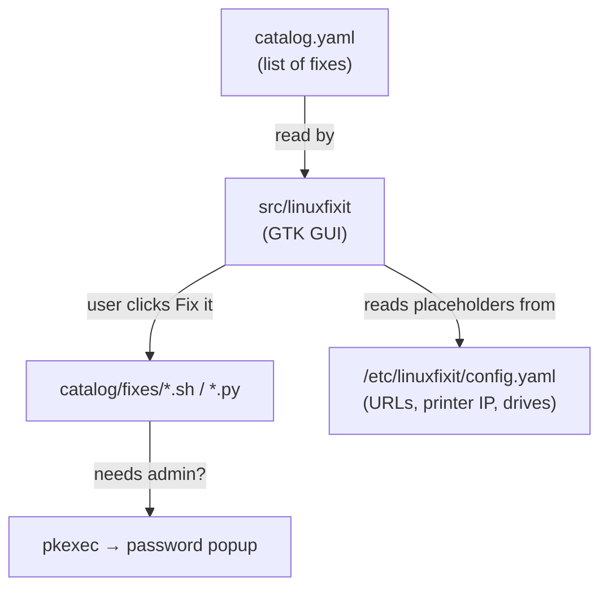
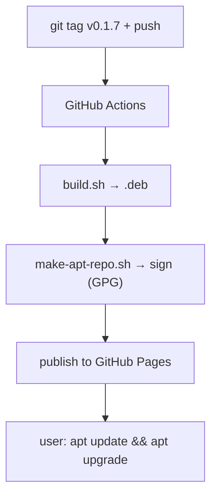
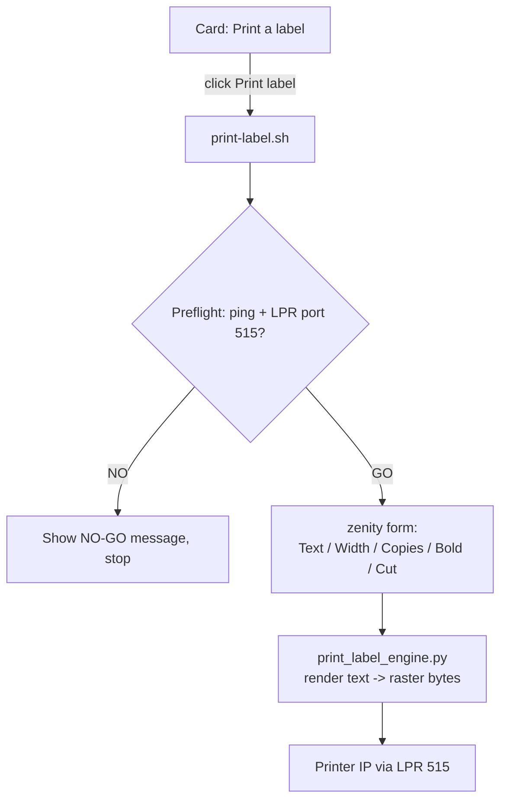

# LinuxFixIt

A self-service GTK app for domain-joined Ubuntu machines. It gives users
one-click script fixes (with admin authentication where needed) and
step-by-step cards for manual fixes — so common problems can be solved without
filing an IT ticket.

## Contents

- [Features](#features)
- [How it works](#how-it-works)
- [Repository layout](#repository-layout)
- [Fix catalog](#fix-catalog)
- [Install on a user machine](#install-on-a-user-machine)
- [Configuration](#configuration)
- [Run from source (development)](#run-from-source-development)
- [Building & versioning](#building--versioning)
- [Automated releases & auto-update (CI/CD)](#automated-releases--auto-update-cicd)
- [Printer labels](#printer-labels)
- [Troubleshooting](#troubleshooting)
- [Documentation](#documentation)

## Features

- **One-click script fixes** — run a vetted shell script with a single button;
  fixes that touch the system request an admin password via `pkexec`.
- **Manual step cards** — numbered, copyable instructions with optional
  screenshots for fixes that can't be fully automated.
- **Hybrid cards** — manual steps followed by a "Fix it" button (e.g. Citrix:
  download by hand, then click to finish).
- **Live output** — scripts stream their output into a window in real time, with
  a clear success/failure result.
- **Site-agnostic** — URLs, drive paths and the printer IP come from a config
  file, so the same package works at any site by shipping a different config.
- **Built-in feedback** — every action is logged locally so IT can see where
  users get stuck.
- **Network label printing** — print to a Brother PT-P950NW with no Brother
  driver/SDK required (see [Printer labels](#printer-labels)).

## How it works



**Data** (`catalog.yaml`, `config.yaml`) is kept separate from **code** (the GUI
and scripts). To adapt to a new site you edit YAML, not code.

## Repository layout

- `src/linuxfixit` — the application (Python / GTK4 / libadwaita)
- `catalog/catalog.yaml` — the list of all fixes (data)
- `catalog/fixes/` — one script per fix (`*.sh`, plus the label engine `*.py`)
- `catalog/images/` — screenshots used by manual step cards
- `packaging/build.sh` — builds the `.deb` package (version from git tag)
- `packaging/make-apt-repo.sh` — builds a signed APT repository
- `packaging/setup-repo.sh` — user-side script to subscribe to auto-updates
- `packaging/linuxfixit.desktop` — app launcher entry
- `.github/workflows/release.yml` — CI: build + sign + publish on a `v*` tag
- `config.example.yaml` — template config (safe, fake values)
- `docs/` — in-depth learning guides (see [Documentation](#documentation))

## Fix catalog

The fixes currently shipped in `catalog/catalog.yaml`:

| Category | Title | Type | Admin? | Script |
|---|---|---|---|---|
| Domain / Login | Domain login takes very long | script | yes | `fix-sssd-login.sh` |
| Office applications | Add web shortcuts for Microsoft 365 | script | yes | `install-m365-webapps.sh` |
| Office applications | Add a web shortcut for Outlook | script | yes | `install-outlook-webapp.sh` |
| Office applications | Remove the Microsoft 365 web shortcuts | script | yes | `uninstall-m365-webapps.sh` |
| Office applications | OnlyOffice cannot access network drives | script | no | `onlyoffice-qdrev.sh` |
| Network | Auto-connect to DTUsecure (stop wallet prompt) | script | no | `fix-dtusecure-wifi.sh` |
| Network drives | Clear stalled network drives (P and Q) | script | yes | `clear-network-drives.sh` |
| Printers | Print a label (Brother PT-P950NW) | script | no | `print-label.sh` |
| Printers | Set up the FollowMe printer (new print server or queue) | script | yes (asks itself) | `setup-followme-printer.sh` + `setup-followme-printer-root.sh` |
| Optional software | Install Cisco VPN (DTU) | manual | — | (steps only) |
| Optional software | Install Citrix Workspace | manual + action | yes | `citrix-install.sh` |

> Adding a fix = drop a script in `catalog/fixes/` and add an entry to
> `catalog/catalog.yaml`. No changes to `src/linuxfixit` are needed.

## Install on a user machine

There are two ways to install. **Method A (APT repository)** is recommended
because it also gives **automatic updates**. **Method B** is a one-off manual
install from a `.deb` file.

### Method A — subscribe to the APT repo (recommended, auto-updates)

Run once on each user machine (also foldable into a USB onboarding script):

```bash
curl -fsSL https://tianw12.github.io/linuxfixit/setup-repo.sh | sudo bash
sudo apt-get install linuxfixit
```

From then on, new releases appear in the normal system updater automatically.
See [Automated releases & auto-update (CI/CD)](#automated-releases--auto-update-cicd)
for how this is published.

### Method B — manual `.deb` install

#### 1. Build the package (once, on a dev machine)

```bash
bash packaging/build.sh        # version is derived from the git tag automatically
```

This produces `build/linuxfixit_<version>_all.deb`. You can still force a
version: `bash packaging/build.sh 0.1.9`. See
[Building & versioning](#building--versioning).

#### 2. Install the package on the user machine

```bash
sudo apt install ./linuxfixit_<version>_all.deb
```

Use `apt install ./file.deb` (not `dpkg -i`) so dependencies are pulled in
automatically: `python3`, `python3-gi`, `python3-yaml`, `gir1.2-gtk-4.0`,
`gir1.2-adw-1`, `policykit-1`, `python3-pil`, `zenity`.

#### 3. Create the real config

The package ships only `config.example.yaml`. Create the real config with
your organization's values:

```bash
sudo mkdir -p /etc/linuxfixit
sudo tee /etc/linuxfixit/config.yaml > /dev/null << 'EOF'
netdrive_paths:
  - "/mnt/YourDrive1"
  - "/mnt/YourDrive2"
vpn_url: "https://vpn.example.com/download/"
citrix_url: "https://www.citrix.com/downloads/workspace-app/linux/"
printer_ip: "PRINTER_IP_HERE"
EOF
```

`config.yaml` is git-ignored and never uploaded. The app reads it from
`/etc/linuxfixit/config.yaml` to fill in placeholders (drive paths, VPN and
Citrix URLs) in the fix steps. If it's missing, the app still runs but shows
the raw placeholders.

#### 4. Run it

Launch **LinuxFixIt** from the applications menu, or run:

```bash
linuxfixit
```

## Run from source (development)

```bash
# install dependencies
sudo apt install python3 python3-gi python3-yaml gir1.2-gtk-4.0 gir1.2-adw-1 policykit-1

# copy the example config (optional, for correct placeholder values)
sudo mkdir -p /etc/linuxfixit
sudo cp config.example.yaml /etc/linuxfixit/config.yaml   # then edit it

# run
./src/linuxfixit
```

When run from source, the app automatically uses the local `catalog/` folder.

## Configuration

The app reads site-specific values from `/etc/linuxfixit/config.yaml`. Keys:

| Key | Used by | Example |
|---|---|---|
| `netdrive_paths` | `onlyoffice-qdrev.sh` (grants OnlyOffice access) | list of mount paths |
| `vpn_url` | Cisco VPN manual card (`{vpn_url}` placeholder) | download page URL |
| `citrix_url` | Citrix manual card (`{citrix_url}` placeholder) | download page URL |
| `printer_ip` | `print-label.sh` (label printing) | `192.0.2.50` |
| `followme_server`, `followme_queue` | FollowMe card (pre-fills the questions) | `print.example.com`, `FollowMe-Queue-Name` |
| `followme_local_name`, `followme_domain` | FollowMe card | `FollowMe-MFP-PCL`, `WIN` |
| `followme_ppd` | FollowMe card, only if no Konica PPD is on the PC | `/path/to/KOC751iUX.ppd` |

Notes:

- The package ships only `config.example.yaml` (fake values). The real
  `config.yaml` is **never** committed or packaged — `build.sh` includes a
  safety check that verifies this.
- Placeholders are written as `{key}` in catalog step text and replaced at
  runtime. Unknown keys are left untouched.

## Building & versioning

`packaging/build.sh` derives the package version from **git tags**, so you never
type a version by hand:

| Situation | Resulting version |
|---|---|
| On an exact tag `v0.1.7` | `0.1.7` |
| 5 commits after `v0.1.7` | `0.1.7+5.gabc1234` |
| No tags / not a git checkout | `0.0.0~dev<YYYYMMDD>` |
| Explicit argument `build.sh 0.1.9` | `0.1.9` (manual override) |

Cutting a release is therefore just:

```bash
git tag v0.1.7
git push origin v0.1.7
```

## Automated releases & auto-update (CI/CD)

Pushing a `v*` tag triggers `.github/workflows/release.yml`, which:

1. builds the `.deb` (`packaging/build.sh`),
2. builds a **GPG-signed** APT repository (`packaging/make-apt-repo.sh`),
3. publishes it to **GitHub Pages**.

User machines that ran `setup-repo.sh` (Method A) then receive the update
through the normal system updater.



One-time setup (signing key in GitHub Secrets, Pages source, etc.) and the full
line-by-line explanation are in
[docs/CICD-EXPLAINED.md](docs/CICD-EXPLAINED.md).

**Security:** the APT repo is GPG-signed and served over HTTPS, so hosting on
public GitHub is safe. Keep the signing private key only in GitHub Actions
Secrets, enable 2FA on the account, and only publish tagged releases.

## Notes

- User feedback is logged locally to `~/.local/share/linuxfixit/feedback.csv`.
- Root-level fixes prompt for an administrator password via `pkexec`.
- Scripts run on a background thread and stream output live; an exit code of
  `126`/`127` means the admin password prompt was cancelled.


## Printer labels

The **Print a label** card prints directly to a Brother PT-P950NW over the
network — no Brother driver, SDK, or printer serial number needed. It only
needs the printer's IP (from `config.yaml`) and to be on the same subnet.

How it works:

1. The card runs `catalog/fixes/print-label.sh`, which does a preflight check
   (ping + LPR port 515), then shows a form for text, tape width, copies, bold,
   half-cut, and chain.
2. The script calls `catalog/fixes/print_label_engine.py`, which renders the
   text to an image and converts it into **raster** data — the printer prints
   one vertical line of dots at a time, so the engine turns the image into rows
   of on/off pins (Brother's "raster" command format) and streams those bytes
   straight to the printer over LPR (TCP 515).

Cutting behaviour:

- **Normal** (no chain): each copy is sent as its own job and is fed out and
  cut automatically.
- **Chain**: all copies print connected with no cuts between them, then the
  printer cuts once at the end and still ejects the last label — no need to
  press the cutter button.



## Troubleshooting

| Symptom | Likely cause / fix |
|---|---|
| App won't start, "Could not load catalog" | `catalog/catalog.yaml` missing or invalid YAML. |
| Steps show raw `{vpn_url}` etc. | `/etc/linuxfixit/config.yaml` is missing or lacks that key. |
| A root fix does nothing | Admin password prompt was cancelled (exit code 126/127). |
| Label won't print, "cannot reach printer" | PC not on the printer's subnet, or `printer_ip` wrong in config. |
| Label reaches printer but "LPR port closed" | Firewall/VLAN blocks TCP 515; contact the network admin. |
| FollowMe: a login box pops up on every print | The queue is marked as needing a login. Run the FollowMe card, or `sudo lpadmin -p FollowMe-MFP-PCL -o auth-info-required=none`. |
| FollowMe: jobs vanish, log says `NT_STATUS_LOGON_FAILURE` | Saved password is old. Run the FollowMe card again after a DTU password change. |
| `apt-get install linuxfixit` not found | Run `setup-repo.sh` first (Method A) and `sudo apt-get update`. |

## Documentation

