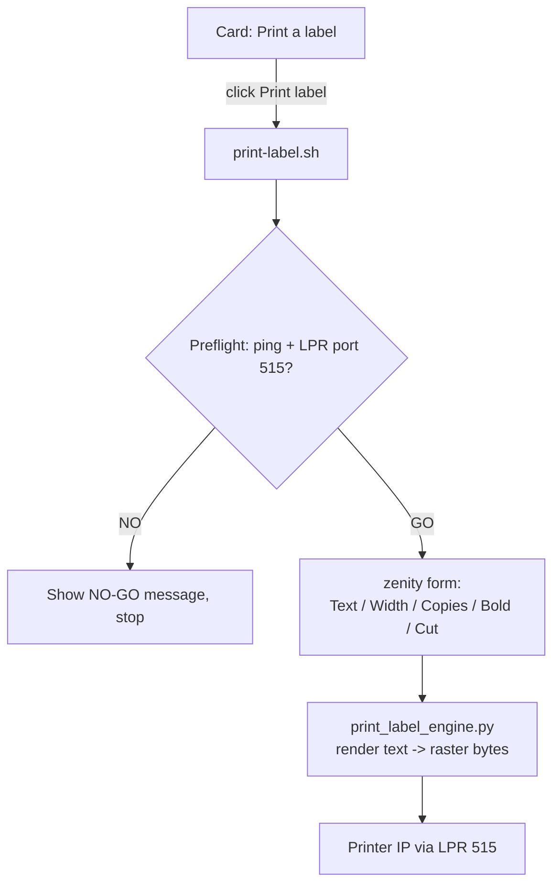

# LinuxFixIt 

A self-service GTK app for domain-joined Ubuntu machines. It gives users
one-click script fixes (with admin authentication where needed) and
step-by-step cards for manual fixes.

## Repository layout

- `src/linuxfixit` — the application (Python / GTK4 / libadwaita)
- `catalog/` — the fixes catalog (`catalog.yaml` + `fixes/*.sh`)
- `packaging/build.sh` — builds the `.deb` package
- `packaging/linuxfixit.desktop` — app launcher entry
- `config.example.yaml` — template config (safe, fake values)

## Install on a user machine

### 1. Build the package (once, on a dev machine)

```bash
bash packaging/build.sh 0.1.x
```

This produces `build/linuxfixit_0.1.x_all.deb`.

### 2. Install the package on the user machine

```bash
sudo apt remove fixhelper
sudo apt install ./linuxfixit_0.1.x_all.deb
```

Use `apt install ./file.deb` (not `dpkg -i`) so dependencies are pulled in
automatically: `python3`, `python3-gi`, `python3-yaml`, `gir1.2-gtk-4.0`,
`gir1.2-adw-1`, `policykit-1`.

### 3. Create the real config

The package ships only `config.example.yaml`. Create the real config with
your organization's values:

```bash
sudo mkdir -p /etc/linuxfixit
sudo tee /etc/linuxfixit/config.yaml > /dev/null << 'EOF'
netdrive_paths:
  - "/mnt/YourDrive1"
  - "/mnt/YourDrive2"
vpn_url: "https://vpn.example.com/download/"
citrix_url: "https://www.citrix.com/downloads/workspace-app/linux/"
printer_ip: "PRINTER_IP_HERE"
EOF
```

`config.yaml` is git-ignored and never uploaded. The app reads it from
`/etc/linuxfixit/config.yaml` to fill in placeholders (drive paths, VPN and
Citrix URLs) in the fix steps. If it's missing, the app still runs but shows
the raw placeholders.

### 4. Run it

Launch **LinuxFixIt** from the applications menu, or run:

```bash
linuxfixit
```

## Run from source (development)

```bash
# install dependencies
sudo apt install python3 python3-gi python3-yaml gir1.2-gtk-4.0 gir1.2-adw-1 policykit-1

# copy the example config (optional, for correct placeholder values)
sudo mkdir -p /etc/linuxfixit
sudo cp config.example.yaml /etc/linuxfixit/config.yaml   # then edit it

# run
./src/linuxfixit
```

When run from source, the app automatically uses the local `catalog/` folder.

## Notes

- User feedback is logged locally to `~/.local/share/linuxfixit/feedback.csv`.
- Root-level fixes prompt for an administrator password via `pkexec`.


## Printer labels

The **Print a label** card prints directly to a Brother PT-P950NW over the
network — no Brother driver, SDK, or printer serial number needed. It only
needs the printer's IP (from `config.yaml`) and to be on the same subnet.

How it works:

1. The card runs `catalog/fixes/print-label.sh`, which does a preflight check
   (ping + LPR port 515), then shows a form for text, tape width, copies, bold,
   half-cut, and chain.
2. The script calls `catalog/fixes/print_label_engine.py`, which renders the
   text to an image and converts it into **raster** data — the printer prints
   one vertical line of dots at a time, so the engine turns the image into rows
   of on/off pins (Brother's "raster" command format) and streams those bytes
   straight to the printer over LPR (TCP 515).

Cutting behaviour:

- **Normal** (no chain): each copy is sent as its own job and is fed out and
  cut automatically.
- **Chain**: all copies print connected with no cuts between them, then the
  printer cuts once at the end and still ejects the last label — no need to
  press the cutter button.

